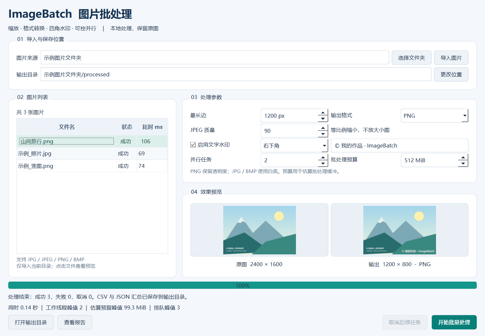

# ImageBatch · C++ 图片批处理工具

使用 **C++17 + Qt Widgets** 开发的 Windows 桌面工具：导入文件夹，预览效果，并行缩放、转换格式并添加文字水印。图片在本地处理，原图保持不变。当前版本 **v1.1.0**。

[下载 Windows 程序包](https://github.com/Mediterranean-with-dreams/cpp-image-batch/releases/latest) · [设计说明](docs/设计说明.md) · [测试报告](docs/测试报告.md) · [性能记录](docs/benchmarks/local-36-images/report.md)



## 使用

完整解压 `ImageBatch-1.1.0-windows-x64.zip` 后双击 `ImageBatch.exe`。程序包自带运行依赖，无需安装开发环境。目标系统为 Windows 10 / 11 x64；本机验收平台为 Windows 10 22H2。

1. 点击“选择文件夹”，或输入路径后点击“导入图片”。
2. 设置最长边、输出格式、JPEG 质量及可选水印；点击图片查看预览。水印可选四个角。
3. 点击“开始批量处理”。默认保存到来源目录下的 `processed` 文件夹。
4. 默认同时处理 2 张图片、估算缓冲区预算 512 MiB；内存较少时选择 1 个任务或降低预算。
5. 处理结束后查看 CSV 明细和同名 JSON 汇总。取消后，已开始处理的图片正常完成，其余任务记为取消。

`samples` 文件夹提供程序生成的示例图片，可直接用于试用。

## 功能与边界

| 项目 | 行为 |
| --- | --- |
| 输入 | JPG / JPEG / PNG / BMP，扩展名不区分大小写；仅扫描当前文件夹 |
| 缩放 | 等比例缩小，默认最长边 1920 px；0 表示保持尺寸；不放大小图 |
| 输出 | JPG / PNG / BMP；JPEG 质量 1～100，默认 90 |
| 透明度 | PNG 保留透明度；JPG 和 BMP 使用白色背景 |
| 水印 | 四角可选，最多 100 个字符，字体随图像尺寸与文字宽度调整 |
| 预览 | 后台生成；JPG 预览包含质量参数对应的编码效果 |
| 文件保护 | 保留原图；输出目录与来源目录分开；输出名加 `_processed`，重名追加编号 |
| 并发调度 | 自行实现 C++17 固定线程池、有界任务队列和生产者背压，支持 1～8 个工作线程 |
| 资源控制 | 解码前按图片尺寸估算缓冲区需求，通过 RAII 预留与释放预算；单图超预算会报错 |
| 错误与取消 | 单张失败后继续；排队或等待预算的任务响应取消；已开始处理的任务完成 |
| 报告 | UTF-8 BOM CSV 记录路径、状态、错误、尺寸与单图耗时；JSON 记录任务数、耗时及调度峰值 |

读取时应用照片方向信息；输出不承诺保留原始 EXIF、GPS 等元数据。有效颜色配置转换到 sRGB。单张解码使用 Qt 的 256 MiB 分配限制，超限图片会报错。批处理预算是图像缓冲区的估算准入额度，**不是进程内存硬上限**，不包含界面、预览和编码库等全部开销。JPEG 是有损编码，处理后文件不保证一定更小。目前不含 GIF、RAW、HEIC、递归扫描、裁剪及 AI 模型功能。

## 环境隔离与构建

开发依赖放在项目 `.tools` 中，版本由 [environment.json](environment.json) 管理：Qt 6.8.3、MinGW 13.1.0、CMake 3.31.6、Ninja 1.11.1.4、aqtinstall 3.3.0。脚本临时设置进程环境并在结束时恢复，不修改系统 PATH，也不影响其他 C++ 项目。下载的 SDK 不提交 Git。

```text
.tools/Qt/6.8.3/mingw_64/      Qt SDK
.tools/Qt/Tools/mingw1310_64/  配套编译器
.tools/python/                aqtinstall、CMake、Ninja
src/                          处理逻辑、后台任务、图形界面
tests/                        Qt Test 与独立标准 C++ 并发测试
tools/                        基准测试程序
scripts/                      安装、构建、测试与运行入口
build-windows/                构建和测试证据
dist/                         可运行程序包
```

在项目目录运行 PowerShell：

```powershell
# 首次准备需要联网；可用 -PythonPath 指定现有 Python 3.10+。
powershell -NoProfile -ExecutionPolicy Bypass -File .\scripts\Setup-Environment.ps1
powershell -NoProfile -ExecutionPolicy Bypass -File .\scripts\Build.ps1
powershell -NoProfile -ExecutionPolicy Bypass -File .\scripts\Test.ps1
powershell -NoProfile -ExecutionPolicy Bypass -File .\scripts\Benchmark.ps1 -Images 36 -Repeats 3
powershell -NoProfile -ExecutionPolicy Bypass -File .\scripts\Package.ps1
powershell -NoProfile -ExecutionPolicy Bypass -File .\scripts\Test-Package.ps1
powershell -NoProfile -ExecutionPolicy Bypass -File .\scripts\Run.ps1
```

`Bypass` 仅对该次 PowerShell 进程生效。安装脚本在没有可用 Python 时下载项目专用的嵌入式 Python；软件本身由 C++ 编译生成，运行不需要 Python。维护方式见 [环境说明](docs/环境说明.md)。

## 代码结构与学习点

- `processor`：参数检查、目录扫描、图像缩放和水印、无覆盖保存、CSV 报告。
- `threadpool`：标准 C++ 线程、互斥锁、条件变量、有界 FIFO 队列、future 异常传递和析构等待。
- `resourcebudget`：可取消的加权额度等待，使用可移动 RAII 租约自动归还资源。
- `batchengine`：连接线程池、资源预算与图片处理，按输入顺序汇总结果，隔离单图错误。
- `batchworker`：Qt 后台协调线程，将引擎回调转换成信号；队列满时的等待不发生在界面线程。
- `mainwindow`：窗口、后台预览、用户操作与结果展示；工作线程不直接操作界面。
- `packagecheck`：开发验收入口 `ImageBatch.exe --self-test <报告.json>`，驱动同一窗口完成真实批处理。

Qt 提供图像解码与编码，本项目实现调度、资源准入、处理流程、交互和错误处理。完整数据流与并发约束见 [设计说明](docs/设计说明.md)，后续学习可参考 [项目介绍与面试准备](docs/项目介绍与面试准备.md)。

## 测试

`scripts/Test.ps1` 运行 Qt Test、独立 C++ 运行时测试和 CTest；JUnit XML、日志、截图和示例图保存在 `build-windows/evidence`。覆盖图像正确性、原图保护、窗口流程、并发重名、取消、预算等待、队列背压和资源释放。GitHub Actions 还在 Linux 上为独立运行时执行 AddressSanitizer / UndefinedBehaviorSanitizer 检查；桌面程序的正式构建目标仍是 Windows。

`scripts/Test-Package.ps1` 将 ZIP 解压到独立目录，移除 Qt 开发路径、只保留 Windows 系统 PATH，再运行实际 EXE 完成一次批处理。该检查验证当前电脑上的分发包独立性；结论及限制见 [测试报告](docs/测试报告.md)。

## 性能基准

本机固定 36 张合成 JPG/PNG 图片，每种线程数测量 3 次；使用相同缩放、编码与水印参数。1 / 2 / 4 线程耗时中位数分别为 **3.793 / 2.078 / 1.336 秒**，4 线程相对 1 线程约 **2.84 倍**加速。9 次测量的输出 SHA-256 与预热结果一致，原图哈希不变。

该结果只对应记录中的电脑与合成负载，不保证其他图片或机器得到相同加速。计时包括批处理及报告写入；文件缓存未清空。原始 JSON、逐次耗时和协议见 [性能记录](docs/benchmarks/local-36-images/report.md)。脚本同时记录估算预算峰值和每 5 ms 采样的进程工作集，两者含义不同。

## 许可证

源码采用 [MIT](LICENSE)。Qt 和运行库采用各自许可证，见 [第三方说明](THIRD_PARTY_NOTICES.md)。示例图由测试代码绘制，无私人照片或网络素材。
